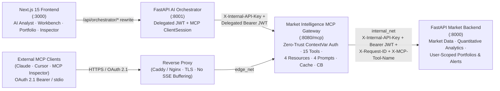

# Market Intelligence Platform & MCP Gateway (`MCP-Server`)

An end-to-end **Zero-Trust Market Intelligence Platform** built around a standalone **Model Context Protocol (MCP) Gateway** (`market-intelligence-mcp`) in Python 3.12 (`mcp[cli]==2.3.0`, Pydantic v2). It serves both an in-product **Next.js 15 AI Terminal** via a **FastAPI AI Orchestrator** and external MCP clients (Claude Desktop, Cursor, OpenAI, MCP Inspector) over **Streamable HTTP** and **stdio**.

---

## Architecture



### Design Principles

- **Strict Service Boundary:** The MCP gateway (`market-intelligence-mcp`) never connects directly to any database. Primary domain state and historical series live in `market-backend`; the MCP layer performs schema validation, deterministic math, context-window compaction, caching, and resilience wrapping.
- **Zero-Trust Identity Propagation:** No `@mcp.tool()` exposes `user_id`, `api_key`, or token fields to the LLM. Incoming HTTP callers authenticate via ASGI middleware, which binds an immutable `RequestSecurityContext` into a `contextvars.ContextVar` and forwards `X-Internal-API-Key`, `Authorization: Bearer <jwt>`, `X-Request-ID`, and `X-MCP-Tool-Name` to the FastAPI backend.
- **Financial Data Rigor:** Every tool returns a structured `ResponseEnvelope` paired with a compact Markdown summary, explicitly separating `OK`, `STALE_DATA`, `NO_DATA_AVAILABLE`, `UNSUPPORTED_SYMBOL`, `INVALID_PARAMETERS`, `PERMISSION_DENIED`, `RATE_LIMITED`, and `UPSTREAM_PROVIDER_ERROR`.
- **Single-Flight Caching & Resilience:** Pooled HTTPX client with tenant-isolated SHA-256 `SingleFlightCache` keys (`PUBLIC` vs `sec_ctx.user_id`), bounded jittered retries (`502/503/504`, transport timeouts), and a three-state `CircuitBreaker` (`CLOSED` -> `OPEN` -> `HALF_OPEN`).

---

## Repository Structure

| Path | Service / Asset | Port | Purpose |
| --- | --- | --- | --- |
| [`market-intelligence-mcp/`](market-intelligence-mcp/) | **MCP Protocol Gateway** | `:8080` | Standalone Python 3.12 MCP server (`mcp==2.3.0`) exposing 15 tools, 4 resources + subscriptions, 4 prompts, Zero-Trust ASGI auth, cache, and circuit breaker. |
| [`ai-orchestrator/`](ai-orchestrator/) | **AI Orchestrator** | `:8001` | FastAPI orchestrator & MCP `StreamableHTTP` client minting persona-scoped delegated JWTs; supports deterministic multi-tool planning and optional OpenAI mode (`ORCH_OPENAI_API_KEY`). |
| [`market-backend/`](market-backend/) | **Internal Market Backend** | `:8000` | FastAPI domain backend with synthetic multi-asset OHLCV/fundamentals (`NVDA`, `AMD`, `AAPL`, `MSFT`, `GOOGL`, `AVGO`, `TSM`, `SPY`, `QQQ`, `AZN.L`) and tenant-isolated portfolio `port_123`. |
| [`frontend/`](frontend/) | **Next.js 15 Terminal UI** | `:3000` | App Router UI featuring **AI Analyst** chat with live MCP tool traces, **Market & Compare** charts, **Portfolio & Risk** analytics + rebalance simulator, and an interactive **MCP Inspector**. |
| [`docker-compose.fullstack.yml`](docker-compose.fullstack.yml) | **Full-Stack Compose** | `3000`, `8001` | Containerized deployment isolating `market-backend` and `market-intelligence-mcp` on an internal bridge network (`internal_net`). |
| [`start-dev.ps1`](start-dev.ps1) | **Windows Dev Launcher** | All 4 | One-command PowerShell launcher starting `:8000`, `:8080`, `:8001`, and `:3000` cleanly. |

---

## Quick Start

### Option 1: Docker Compose (All 4 Services)

```bash
docker compose -f docker-compose.fullstack.yml up --build
```

Then open **http://127.0.0.1:3000** in your browser.
*(Optionally set `ORCH_OPENAI_API_KEY` to switch the AI Orchestrator from `deterministic_mcp_planner` to an OpenAI-compatible model.)*

### Option 2: Local Development (Python 3.12 + Node.js 20+)

**1. Install dependencies once per service:**

```bash
# Market Backend (:8000)
cd market-backend && uv venv .venv --python 3.12 && uv pip install --python .venv/Scripts/python.exe -e . && cd ..

# MCP Gateway (:8080)
cd market-intelligence-mcp && uv venv .venv --python 3.12 && uv pip install --python .venv/Scripts/python.exe -e ".[dev]" && cd ..

# AI Orchestrator (:8001)
cd ai-orchestrator && uv venv .venv --python 3.12 && uv pip install --python .venv/Scripts/python.exe -e . && cd ..

# Next.js Frontend (:3000)
cd frontend && npm install && cd ..
```

*(On Linux/macOS, substitute `.venv/bin/python` for `.venv/Scripts/python.exe`.)*

**2. Launch the full stack:**

- **Windows (PowerShell):**
  ```powershell
  .\start-dev.ps1
  ```
- **Manual 4-terminal startup (any OS):**
  ```bash
  # Terminal 1 — Market Backend (:8000)
  cd market-backend && uvicorn app.main:app --host 127.0.0.1 --port 8000

  # Terminal 2 — MCP Gateway (:8080)
  cd market-intelligence-mcp && python -m app.main --transport streamable-http --host 127.0.0.1 --port 8080

  # Terminal 3 — AI Orchestrator (:8001)
  cd ai-orchestrator && uvicorn app.main:app --host 127.0.0.1 --port 8001

  # Terminal 4 — Next.js Frontend (:3000)
  cd frontend && npm run dev
  ```

Open **http://127.0.0.1:3000**.

### Option 3: Standalone MCP Gateway (Claude Desktop / Cursor / MCP Inspector)

```bash
cd market-intelligence-mcp
cp .env.example .env
python -m app.main --transport stdio
# or with MCP Inspector:
npx @modelcontextprotocol/inspector python -m app.main --transport stdio
```

See [`market-intelligence-mcp/README.md`](market-intelligence-mcp/README.md) and [`market-intelligence-mcp/docs/client-integration.md`](market-intelligence-mcp/docs/client-integration.md) for reverse-proxy HTTPS + OAuth 2.1 client configurations.

---

## Using the Web Terminal & Testing RBAC

The header persona switcher lets you observe Zero-Trust scope enforcement live across the UI:

| Persona | User ID | Scopes | Expected Behavior |
| --- | --- | --- | --- |
| **Alice** *(Portfolio Manager)* | `user_alice` | `market:read`, `portfolio:read`, `portfolio:write`, `simulation:execute`, `research:write` | Full access to all 15 tools, portfolio `port_123` VaR/CVaR analytics, rebalance simulations, watchlists, price alerts, and research memos. |
| **Bob** *(Read-Only Analyst)* | `user_bob` | `market:read` | Can run market discovery, quotes, history, indicators, and comparisons (`Market & Compare` / `AI Analyst`), while portfolio/write/simulation actions fail closed with `PERMISSION_DENIED`. |

Try these sample queries in **AI Analyst** (`:3000`):
- `Compare NVDA vs AMD over 1M`
- `Generate institutional tearsheet for NVDA`
- `Audit portfolio tail risk and simulate rebalance` *(succeeds as Alice, denied as Bob)*
- `Compare NVDA vs AZN.L over 3M cross-exchange`

---

## MCP Protocol Capabilities

- **15 Tools:**
  - *Discovery & Market Data (`market:read`):* `search_instruments`, `get_exchange_schedule`, `get_company_profile`, `get_market_quote`, `get_historical_prices`
  - *Fundamentals & Quant (`market:read`):* `get_financial_metrics`, `get_earnings_history`, `calculate_returns`, `calculate_technical_indicators`, `compare_instruments`
  - *Portfolio & Risk (`portfolio:read` / `simulation:execute`):* `analyse_portfolio`, `simulate_portfolio_rebalance`
  - *Workspace Writes (`portfolio:read`/`write`, `research:write`):* `manage_watchlist`, `create_price_alert`, `save_research_memo`
- **4 Resources (+ Subscriptions via `subscriptions/listen` & `resources/subscribe`):**
  - `market://system/capabilities` · `market://system/glossary` · `market://instrument/{symbol}/snapshot` · `portfolio://user/{portfolio_id}/summary`
- **4 Workflow Prompts:**
  - `institutional_equity_tearsheet` · `multi_stock_relative_value_comparison` · `pairs_trading_screen` · `portfolio_tail_risk_audit`

Full request/response contracts and formulas are documented in [`market-intelligence-mcp/docs/tools-reference.md`](market-intelligence-mcp/docs/tools-reference.md).

---

## Verification & Test Suites

```bash
# 1. MCP Gateway unit, integration & zero-trust security tests (respx-mocked backend)
cd market-intelligence-mcp
.venv/Scripts/python.exe -m pytest -v

# 2. Live 3-tier end-to-end test (ai-orchestrator -> market-intelligence-mcp -> market-backend)
cd ..
ai-orchestrator/.venv/Scripts/python.exe -m pytest ai-orchestrator/tests/test_fullstack_e2e.py -v

# 3. Frontend static typecheck & production build
cd frontend
npm run typecheck
npm run build
```

---

## Documentation Index

- [`market-intelligence-mcp/README.md`](market-intelligence-mcp/README.md) — Deep dive into the MCP gateway
- [`market-intelligence-mcp/docs/architecture.md`](market-intelligence-mcp/docs/architecture.md) — Security boundary, caching, and circuit breaker design
- [`market-intelligence-mcp/docs/backend-route-contract.md`](market-intelligence-mcp/docs/backend-route-contract.md) — Complete FastAPI internal route mapping matrix
- [`market-intelligence-mcp/docs/tools-reference.md`](market-intelligence-mcp/docs/tools-reference.md) — Tool, resource, prompt & `ResponseEnvelope` schemas
- [`market-intelligence-mcp/docs/client-integration.md`](market-intelligence-mcp/docs/client-integration.md) — Orchestrator, Claude Desktop, Cursor & MCP Inspector setup
