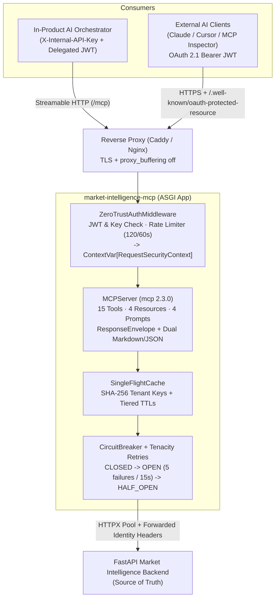

# Market Intelligence MCP Server (`market-intelligence-mcp`)

A standalone, production-grade **Model Context Protocol (MCP)** gateway built in Python 3.12 using the official MCP SDK (`mcp[cli]==2.3.0`) and Pydantic v2 (`>=2.9`). It serves **15 quantitative market, fundamental, portfolio risk, and controlled workspace tools**, **4 resources with live subscriptions**, and **4 institutional workflow prompts**, sitting strictly in front of an internal FastAPI Market Intelligence Backend with zero direct database access.

---

## Architecture Overview



---

## Core Guarantees

### 1. Zero-Trust Identity Propagation (`app/auth/`)
- **No LLM-Spoofable Parameters:** None of the 15 `@mcp.tool()` functions accept `user_id`, `api_key`, or `token` arguments.
- **Dual HTTP Authentication Flows:**
  1. **Internal Service-to-Service + Delegated User:** Constant-time comparison (`secrets.compare_digest`) of `X-Internal-API-Key` paired with a verified delegated user JWT in `Authorization: Bearer <token>`.
  2. **External OAuth 2.1 Resource Server:** Validates OAuth 2.1 Bearer JWTs (`iss`, `aud`, `exp`, `sub`, `scope`/`scp`, signature via JWKS or public key) and serves RFC 9728 metadata at `GET /.well-known/oauth-protected-resource`.
- **`ContextVar` Propagation:** `ZeroTrustAuthMiddleware` binds an immutable `RequestSecurityContext` into a `contextvars.ContextVar` and populates Starlette's `scope["user"]` so `Mcp-Session-Id` stays bound to the originating principal. `BackendClient` automatically attaches `X-Internal-API-Key`, `Authorization: Bearer <jwt>`, `X-Request-ID`, and `X-MCP-Tool-Name` to outbound FastAPI requests.

### 2. Standardized Financial `ResponseEnvelope` (`app/schemas/common.py`)
Every tool returns a dual-formatted `CallToolResult` (`structured_content` JSON conforming to `ResponseEnvelope[T]` plus a compact Markdown block) containing:
- `status`: `OK` | `STALE_DATA` | `NO_DATA_AVAILABLE` | `UNSUPPORTED_SYMBOL` | `INVALID_PARAMETERS` | `PERMISSION_DENIED` | `RATE_LIMITED` | `UPSTREAM_PROVIDER_ERROR`
- `metadata`: `source`, `data_timestamp` (ISO-8601 UTC), `fetched_at` (ISO-8601 UTC), `is_stale`, `staleness_threshold_seconds`, `currency`, `units`, `calendar_type` (`TRADING_DAYS` | `CALENDAR_DAYS`), `cache_hit`, `request_id`
- `warnings` & `error`: Non-fatal staleness/calendar caveats, or sanitized `ErrorDetail` (`code`, `message`, `retryable`, `details`).

### 3. Single-Flight Caching & Upstream Resilience (`app/clients/`)
- **Tenant-Isolated Keys:** Cache keys hash `(tenant_scope, method, endpoint, canonical_params, canonical_body)` using SHA-256 (`"PUBLIC"` for shared market endpoints; `sec_ctx.user_id` for user-scoped portfolio/watchlist/research routes).
- **Single-Flight Coalescing:** Concurrent identical misses await one shielded `asyncio.Future` so upstream never suffers thundering-herd spikes.
- **Circuit Breaker & Retries:** Opens after 5 consecutive upstream 5xx/transport failures for a 15s cooldown (`UPSTREAM_CIRCUIT_OPEN`) and allows a single probe in `HALF_OPEN`. Retries up to 2 times with full jitter strictly on `ConnectError`, `ReadTimeout`, `PoolTimeout`, and HTTP `502`/`503`/`504`.
- **Observability:** Structured JSON logging via `structlog` (`app/config/logging.py`) with recursive secret, JWT, API key, and header redaction, plus `/health/live` and `/health/ready` probes.

---

## Capability Inventory

### Tools (15)

| Category | Tool | Scope | Cache TTL | Purpose |
| --- | --- | --- | --- | --- |
| Discovery | `search_instruments` | `market:read` | `300s` | Search equities, ETFs, indices, crypto, FX by query/ISIN/FIGI |
| Discovery | `get_exchange_schedule` | `market:read` | `3600s` | Market state (`OPEN`/`CLOSED`/extended), trading hours, holidays |
| Discovery | `get_company_profile` | `market:read` | `86400s` | GICS sector/industry, CEO, headcount, listing metadata |
| Market Data | `get_market_quote` | `market:read` | `5s` | Level-1 quote, bid/ask spread (bps), volume, market cap |
| Market Data | `get_historical_prices` | `market:read` | `60s` / `3600s` | OHLCV bars (max 500/call) with deterministic VWAP & summary stats |
| Fundamentals | `get_financial_metrics` | `market:read` | `3600s` | Valuation, profitability, leverage/liquidity, per-share growth |
| Fundamentals | `get_earnings_history` | `market:read` | `3600s` | EPS/revenue consensus vs. actuals, surprises, next earnings date |
| Analytics | `calculate_returns` | `market:read` | `60s` | Cumulative/log return, CAGR, volatility, max drawdown, Sharpe, alpha, beta |
| Analytics | `calculate_technical_indicators` | `market:read` | `60s` | SMA, EMA, RSI, MACD, Bollinger Bands, ATR, VWAP, OBV & regime signals |
| Analytics | `compare_instruments` | `market:read` | `60s` | Multi-asset (2–10 symbols) aligned comparison, correlation matrix & rankings |
| Portfolio Risk | `analyse_portfolio` | `portfolio:read` | `15s` (User) | NAV, P&L, sector weights, beta, Sharpe/Sortino, VaR/CVaR, concentration |
| Portfolio Risk | `simulate_portfolio_rebalance` | `simulation:execute` | `0s` | Stateless pre/post-trade risk simulation with concentration & cash guardrails |
| Workspace | `manage_watchlist` | `portfolio:read`/`write` | `15s` / `0s` | Idempotent `LIST`/`ADD`/`REMOVE` with cache invalidation & notifications |
| Workspace | `create_price_alert` | `portfolio:write` | `0s` | User-scoped price or 1-day move alert rule |
| Workspace | `save_research_memo` | `research:write` | `0s` | Persist grounded AI research memo referencing cited `data_timestamp`s |

### Resources (4) & Prompts (4)

- **Resources:** `market://system/capabilities` (`application/json`), `market://system/glossary` (`application/json`), `market://instrument/{symbol}/snapshot` (`text/markdown`), `portfolio://user/{portfolio_id}/summary` (`text/markdown`). Supports both `subscriptions/listen` (MCP 2026-07-28) and `resources/subscribe` (MCP 2025-11-25).
- **Prompts:** `institutional_equity_tearsheet`, `multi_stock_relative_value_comparison`, `pairs_trading_screen`, `portfolio_tail_risk_audit`.

---

## Configuration

All runtime settings are prefixed with `MCP_` (loaded via Pydantic `BaseSettings` in [`app/config/settings.py`](app/config/settings.py); see [`.env.example`](.env.example)):

- **Server & Transport:** `MCP_HOST` (`0.0.0.0`), `MCP_PORT` (`8080`), `MCP_STREAMABLE_HTTP_PATH` (`/mcp`), `MCP_ALLOWED_HOSTS`, `MCP_ALLOWED_ORIGINS`
- **Upstream Backend:** `MCP_BACKEND_BASE_URL` (`http://localhost:8000`), `MCP_BACKEND_INTERNAL_API_KEY`, `MCP_BACKEND_MAX_RETRIES` (`2`)
- **Authentication:** `MCP_INTERNAL_API_KEY`, `MCP_INTERNAL_JWT_ISSUER`, `MCP_INTERNAL_JWT_AUDIENCE`, `MCP_INTERNAL_JWT_SECRET`, `MCP_OAUTH_ENABLED`, `MCP_OAUTH_ISSUER`, `MCP_OAUTH_AUDIENCE`, `MCP_OAUTH_JWKS_URL`
- **Resilience:** `MCP_CIRCUIT_BREAKER_FAILURE_THRESHOLD` (`5`), `MCP_CIRCUIT_BREAKER_RECOVERY_TIMEOUT_SECONDS` (`15.0`), `MCP_RATE_LIMIT_REQUESTS` (`120`), `MCP_RATE_LIMIT_WINDOW_SECONDS` (`60`), `MCP_CACHE_MAX_SIZE` (`4096`)

---

## Quick Start

### Local Virtualenv Setup

```bash
# 1. Create Python 3.12 environment and install package + dev dependencies
uv venv .venv --python 3.12
uv pip install --python .venv/Scripts/python.exe -e ".[dev]"   # Linux/macOS: .venv/bin/python

# 2. Configure environment variables
cp .env.example .env

# 3. Run Streamable HTTP server (for orchestrators & remote MCP clients)
python -m app.main --transport streamable-http --host 0.0.0.0 --port 8080

# 4. Run stdio server (for Claude Desktop / local MCP Inspector)
python -m app.main --transport stdio
```

### Health & Readiness Probes

- `GET /health/live` — Liveness status (`{"status": "live"}`)
- `GET /health/ready` — Verifies upstream `/health`, `circuit_breaker` state (`CLOSED` / `OPEN` / `HALF_OPEN`), and cache metrics (`503` when degraded)

### Running Tests & Linting

```bash
pytest -v
ruff check app tests
```

### Container Deployment (Gateway + Caddy TLS Proxy)

```bash
cp .env.example .env
docker compose up --build
```

Production reverse proxy configurations with SSE streaming (`proxy_buffering off` / unbuffered flushing) live in [`deploy/Caddyfile`](deploy/Caddyfile) and [`deploy/nginx.conf`](deploy/nginx.conf).

---

## Further Documentation

- [`docs/architecture.md`](docs/architecture.md) — Topology, ASGI auth middleware, caching, and circuit breaker details
- [`docs/backend-route-contract.md`](docs/backend-route-contract.md) — Route mapping matrix & FastAPI internal contract
- [`docs/tools-reference.md`](docs/tools-reference.md) — Tool schemas, resources, prompts, and `ResponseEnvelope` spec
- [`docs/client-integration.md`](docs/client-integration.md) — Orchestrator, Claude Desktop, Cursor & MCP Inspector configs
